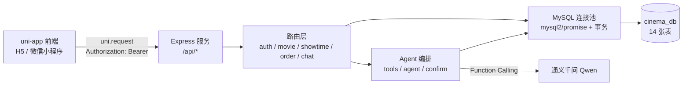

# 星辉影城 · 电影院在线购票系统

一套面向移动端的在线购票系统，覆盖 **影片推荐 → 选场次 → 选座 → 下单支付 → 订单管理 → 观影指南** 全流程，
并内置基于**通义千问 Qwen Function Calling** 的智能购票助手（自然语言下单 / 退票，写操作需二次确认）。

前端采用 uni-app（Vue 3 + Vite + Pinia），一套代码同时构建 **H5** 与 **微信小程序**；
后端为 Node.js + Express + MySQL。数据为真实经典影片的**元数据**（片名、导演、主演、片长、评分、简介），不含任何影片文件与剧照。

---

## 一、功能清单

| 模块 | 实现内容 |
| --- | --- |
| 影片推荐 | 首页轮播、类型筛选（15 类）、搜索、热映/即将上映、评分与票房排序 |
| 影片详情 | 海报占位、导演/主演/类型/时长/语言版本、评分、剧情简介、选场次入口 |
| 场次选择 | 未来 7 天日期切换、影院/影厅/版本/原价与优惠价、剩余座位、满场状态 |
| 选座购票 | 可视化座位图（可售/已售/已选/情侣座）、多选上限 6 张、实时计价 |
| 模拟支付 | 下单 → 支付 / 取消，全程模拟，不接入真实支付渠道 |
| 订单中心 | 状态筛选（待支付/已支付/已完成/已退票/已取消）、详情、真实可扫取票二维码、退票、取消、**清除历史订单** |
| 观影指南 | 购票取票流程、影厅与座位说明、文明观影守则、会员与优惠、常见问题 FAQ |
| 智能助手 | 多轮对话、意图解析为结构化调用、查询/下单/退票，**写操作生成待确认卡片**，支持会话历史 |

### 数据规模

- 影片 **102 部**（39 部热映可购票，63 部即将上映）
- 影片类型 **15 类**、类型关联 227 条
- 影院 2 家、影厅 **7 个**、座位合计 420 个
- 场次 **300 场**（7 厅 × 7 天 × 7 时段，同一影厅同一时段不重复排片）

---

## 二、技术栈

| 层 | 选型 | 说明 |
| --- | --- | --- |
| 前端框架 | Vue 3.4（组合式 API） + uni-app | 一套代码编译 H5 与微信小程序 |
| 构建 | Vite 5 + `@dcloudio/vite-plugin-uni` | 支持 CLI 运行，也可用 HBuilderX 直接打开 |
| 状态管理 | Pinia 2 | `user`（登录态）、`booking`（选座临时态）、`filter`（跨 tabBar 页传参） |
| 请求 | `uni.request` 统一封装 | 注入 JWT、统一错误码 toast、401 跳登录 |
| 二维码 | `qrcode-generator` | 纯 JS 生成矩阵，view 网格渲染，双端一致 |
| 后端 | Node.js + Express 4 | RESTful API，统一响应 `{code,message,data}` |
| 数据库 | MySQL 8（utf8mb4） | `mysql2/promise` 连接池 + 事务 |
| 鉴权 | JWT + bcryptjs | 密码 bcrypt 加密存储 |
| 大模型 | 通义千问 Qwen（`qwen-plus`） | Function Calling 工具调用 |

> 未使用第三方 UI 组件库，统一采用自研 SCSS 组件样式（「胶片暖棕」主题：赤陶红 `#B9462F` + 琥珀金 `#E0A44A` + 暖白纸感底色 `#FAF7F2`），
> 设计变量集中在 `app/src/uni.scss`，以保证双端渲染一致、体积可控，避免 uni-ui/uView 在小程序端的样式差异。

---

## 三、目录结构

```
电影院在线购票系统/
├── app/                        # 前端（uni-app CLI 工程）
│   ├── index.html
│   ├── vite.config.js
│   ├── package.json
│   └── src/
│       ├── App.vue             # 全局样式
│       ├── main.js             # 入口（注册 Pinia）
│       ├── manifest.json       # 应用配置（H5 / mp-weixin）
│       ├── pages.json          # 路由与 tabBar
│       ├── uni.scss            # 主题变量
│       ├── config.js           # 各端 BASE_URL（条件编译）
│       ├── api/                # 请求封装与接口模块
│       ├── store/              # Pinia：user / booking / filter
│       ├── utils/              # 金额、时间、订单状态等格式化
│       ├── components/         # movie-poster 等公共组件
│       └── pages/              # 12 个页面
├── server/                     # 后端
│   ├── app.js                  # 入口
│   ├── .env.example            # 环境变量模板
│   ├── config/db.js            # MySQL 连接池
│   ├── middleware/             # auth（JWT）、errorHandler
│   ├── routes/                 # auth / movie / showtime / order / chat
│   ├── agent/                  # tools（工具定义）、agent（调用编排）、confirm（待确认动作）
│   ├── jobs/occupySeats.js     # 定时占座（模拟真实售票）
│   └── utils/response.js
├── database/
│   ├── init.sql                # 建库建表 + 影院/影厅/座位 + 演示用户
│   ├── seed_movies.sql         # 102 部影片、类型关联、轮播、300 场次（可独立导入）
│   └── seed_movies.js          # 数据生成脚本（导入库 + 重新生成上面的 SQL）
├── docs/
│   ├── 数据库设计.md            # ER 图、表结构字典、索引与关系说明
│   ├── ER图.png                # ER 图图片版（论文 / PPT 可直接使用）
│   ├── API接口文档.md          # 接口详细说明（参数、响应、错误码）
│   ├── 运行截图.md             # 12 个页面的实际运行截图（H5 移动端视口）
│   └── screenshots/            # 截图文件
├── agent.md                    # 项目开发准则
├── 系统开发提示词.md            # 需求与教学目标
└── README.md
```

---

## 四、系统架构



请求链路：页面 → `api/*.js` → [request.js](app/src/api/request.js)（注入 token、统一错误处理）→ 后端路由 → MySQL。
写操作（下单/支付/退票/清除）全部走事务，读操作直接走连接池。

---

## 五、页面与路由

| 页面 | 路径 | 说明 |
| --- | --- | --- |
| 首页（Tab） | `pages/index/index` | 轮播、搜索、类型入口、热映推荐 |
| 影片（Tab） | `pages/movie/list` | 状态筛选、类型筛选、关键词搜索、排序 |
| 订单（Tab） | `pages/order/list` | 状态 Tab、清除历史订单 |
| 我的（Tab） | `pages/user/user` | 登录态、个人信息、快捷入口 |
| 影片详情 | `pages/movie/detail` | 影片信息、类型标签、选场次入口 |
| 选择场次 | `pages/showtime/showtime` | 7 天日期、影厅与版本、剩余座位 |
| 选择座位 | `pages/seat/seat` | 座位图、多选、实时计价、提交订单 |
| 订单详情 | `pages/order/detail` | 支付 / 取消 / 退票、取票二维码 |
| 观影指南 | `pages/guide/guide` | 购票流程、座位说明、文明观影、FAQ |
| 智能助手 | `pages/chat/chat` | 多轮对话、确认卡片、历史会话 |
| 登录 | `pages/login/login` | 账号密码登录 |
| 注册 | `pages/register/register` | 新用户注册 |

> TabBar 页只能用 `uni.switchTab` 跳转且不能带参数，故首页筛选条件通过 Pinia 中转。

---

## 六、快速开始

### 1. 环境要求

- Node.js ≥ 18
- MySQL 8.x
- （可选）HBuilderX、微信开发者工具

### 2. 初始化数据库

```bash
# 建库建表 + 基础数据
mysql -u root -p < database/init.sql

# 导入 102 部影片与 300 场次（二选一）
mysql -u root -p cinema_db < database/seed_movies.sql
# 或者：在 server 目录下执行，脚本会导入库并同时重新生成 seed_movies.sql
node database/seed_movies.js
```

> `seed_movies.js` 依赖 `mysql2`，可在 `server` 目录下运行（会复用其 node_modules）。

### 3. 启动后端

```bash
cd server
copy .env.example .env      # 填写 DB_PASSWORD 与 QWEN_API_KEY
npm install
npm start                   # http://localhost:3000
```

`.env` 关键项：

| 变量 | 说明 |
| --- | --- |
| `DB_HOST` / `DB_PORT` / `DB_USER` / `DB_PASSWORD` / `DB_NAME` | MySQL 连接 |
| `JWT_SECRET` | 令牌签名密钥，生产环境务必更换 |
| `QWEN_API_KEY` | 通义千问 API Key（不配置时助手会返回友好提示） |
| `QWEN_MODEL` | 默认 `qwen-plus` |

启动时会自动执行一次「定时占座」（为未来场次补充已售座位），之后每天 02:00 自动执行。
需要手动触发时：

```bash
npm run occupy
```

### 4. 启动前端（H5）

```bash
cd app
npm install
npm run dev:h5              # http://localhost:5173
```

### 5. 微信小程序

```bash
cd app
npm run build:mp-weixin     # 产物：app/dist/build/mp-weixin
```

用微信开发者工具导入 `app/dist/build/mp-weixin`，AppID 可用测试号，
在「详情 → 本地设置」勾选**不校验合法域名**。

真机调试需：`src/manifest.json` 填写真实 AppID，并把 `src/config.js` 中 `MP-WEIXIN` 分支的
`BASE_URL` 改为电脑局域网 IP（如 `http://192.168.x.x:3000/api`），手机与电脑同一 Wi-Fi。

### 演示账号

| 账号 | 密码 |
| --- | --- |
| `testuser` | `123456` |

（`init.sql` 中已写入 bcrypt 密文，导入后可直接登录）

---

## 七、接口概览

统一响应：`{ code, message, data }`，`code = 0` 表示成功；鉴权接口需请求头 `Authorization: Bearer <token>`。

| 方法 | 路径 | 说明 |
| --- | --- | --- |
| POST | `/api/auth/register` | 注册 |
| POST | `/api/auth/login` | 登录，返回 token 与用户信息 |
| GET | `/api/movie/banner` | 首页轮播 |
| GET | `/api/movie/category` | 影片类型 |
| GET | `/api/movie/cinema` | 影院列表 |
| GET | `/api/movie/hot` | 热门推荐 |
| GET | `/api/movie/list?status&typeId&keyword&sort` | 影片检索 |
| GET | `/api/movie/detail/:id` | 影片详情（含类型标签） |
| GET | `/api/showtime/list?movieId&date` | 场次列表 |
| GET | `/api/showtime/seat/:showtimeId` | 座位图（含已售标记） |
| POST | `/api/order/create` | 下单（`showtimeId` + `seatIds`） |
| POST | `/api/order/pay/:id` | 模拟支付 |
| POST | `/api/order/cancel/:id` | 取消（仅待支付） |
| POST | `/api/order/refund/:id` | 退票（已支付/已完成） |
| POST | `/api/order/clear` | 清除历史订单（已完成/已退票/已取消） |
| GET | `/api/order/list?status` | 订单列表 |
| GET | `/api/order/detail/:id` | 订单详情（含票与座位） |
| POST | `/api/chat/chat` | 与助手对话，返回回复与待确认动作 |
| GET | `/api/chat/session` | 会话列表 |
| GET | `/api/chat/history/:sessionId` | 会话历史 |

---

## 八、智能助手（Agent）设计

1. [tools.js](server/agent/tools.js) 定义 7 个可被模型调用的工具：
   `query_movies`（影片推荐/搜索）、`query_showtimes`（场次）、`query_seats`（座位）、
   `query_orders`（我的订单）、`query_guide`（观影指南问答）、
   `create_order`（下单）、`refund_order`（退票）。
2. 模型在 `qwen-plus` 的 Function Calling 下解析用户意图并返回工具调用；
   `agent.js` 执行工具、把结果回填给模型，形成多轮「补参数 → 执行」闭环。
3. **不可逆写操作**（下单、退票）不直接执行：`confirm.js` 生成 `pendingAction`，
   前端聊天页渲染确认卡片，用户点击确认后才调用真实 `/api/order` 接口。
4. 会话与消息落库（`chat_session` / `chat_message`），支持历史会话恢复。

---

## 九、关键实现说明

- **统一请求封装**：`api/request.js` 注入 token、校验 `code`、401 自动跳登录、错误统一 toast。
- **跨 tabBar 页传参**：tabBar 页只能用 `uni.switchTab` 且不能带 query，
  因此用 `store/filter.js` 中转首页的类型/关键词筛选，列表页 `onShow` 消费。
- **事务一致性**：下单、支付、退票、清除历史均在事务中完成，保证座位占用与订单状态一致。
- **座位冲突校验**：下单前在事务内 `FOR UPDATE` 锁定场次并复查座位是否已被有效票占用。
- **取票二维码**：`qrcode-generator` 生成矩阵后用 view 网格渲染，规避 canvas 在 H5 双端的绘制时机问题。
- **场次排期无冲突**：7 厅 × 7 天 × 7 时段生成组合，同一影厅同一时段只排一部影片，
  同一「日期 + 时段」内各影厅影片互不相同。
- **模拟真实售票**（`server/jobs/occupySeats.js`）：每天 02:00 为未来场次随机占用座位，
  让座位图出现「已售」灰块，贴近真实购票场景。占用以系统账号 `system_booking` 真实下单
  （订单状态 = 已完成），因此座位图、余票数、下单冲突校验全部走原有链路，无需特殊分支。
  细节：每场按 10%–45% 的起售率随机占用、优先选同排连座、每场至少留 4 个空位、
  随机种子由场次 ID + 日期决定（重复执行不会重复占座）、执行后校正 `sold_seat` 计数。

---

## 十、演示流程

一条完整的演示路径（约 3 分钟）：

1. **登录**：首页右上角进入「我的」→ 登录 `testuser / 123456`
2. **找片**：首页点类型卡片（如「剧情」）或搜索「千与千寻」→ 影片列表
3. **看详情**：点海报进入详情，查看导演/主演/类型/评分/简介
4. **选场次**：点「选场次」，切日期看不同影厅与票价，点「选座」
5. **选座**：选 1–6 个座位，底部实时显示「已选 N 座 · 排座明细」与总价 → 提交订单
6. **支付**：进入订单详情，点「立即支付」→ 出现真实可扫取票二维码
7. **订单管理**：订单列表按状态筛选；已支付订单可「退票」；「清除历史订单」清理已完成/已退票/已取消
8. **智能助手**：进入「智能购票助手」，输入「帮我订一张千与千寻的票」→ 多轮补齐场次与座位 → 生成确认卡片 → 确认后真实下单

---

## 十一、测试与验证

本项目在本地完成了接口级与界面级双向验证，主要验收项如下：

| 验证项 | 方式 | 结果 |
| --- | --- | --- |
| 注册 / 登录 / JWT 鉴权 | 接口 | 通过 |
| 未登录访问订单接口 | 接口 | 返回 401 |
| 影片检索（关键词 / 类型 / 排序） | 接口 + 界面 | 通过 |
| 场次按影片与日期筛选 | 接口 + 界面 | 通过 |
| 座位图已售标记 | 接口 | 通过 |
| 下单 → 支付 → 退票全链路 | 接口 + 界面 | 通过 |
| 并发重复选座拦截 | 接口 | 返回「座位已被占用」 |
| 订单详情片名/影院/场次 | 界面 | 通过（修复 JOIN 缺失） |
| 清除历史订单 | 接口 + 界面 | 通过（仅删已完成/已退票/已取消） |
| 场次排期冲突检查 | SQL 校验 | 300 场，0 冲突 |
| 智能助手查询 / 下单 / 退票 | 接口 | 通过，写操作返回确认卡片 |
| H5 与微信小程序编译 | 构建 | 均通过 |

---

## 十二、常见问题

**Q：H5 打开后页面没变化 / 仍是旧样式？**
A：浏览器缓存了旧模块，按 `Ctrl + F5` 强制刷新。

**Q：`npm run dev:h5` 起不来，提示端口被占用？**
A：Vite 默认 5173，被占用时会自动换端口（终端里会打印实际地址）；也可先结束占用进程。

**Q：后端启动报错 `ER_ACCESS_DENIED_ERROR`？**
A：`.env` 里的 `DB_PASSWORD` 与本机 MySQL 不一致，改好后重启 `node app.js`。

**Q：用 PowerShell 调接口，中文变成 `????`？**
A：Windows PowerShell 5.1 的 `Invoke-RestMethod` 按本地编码发送请求体。改用 Postman / Apifox / Node 客户端即可，数据库与服务端均为 utf8mb4，不存在编码问题。

**Q：进入某部影片的场次页是空的？**
A：该片当天没有排片，页面会自动跳到最近有场次的日期；若 7 天内都无排片，说明该片未排片（即将上映影片不排场次）。

**Q：微信小程序请求全部失败？**
A：检查 `src/config.js` 中 `MP-WEIXIN` 的 `BASE_URL` 是否为电脑局域网 IP（不能是 `localhost`），并在开发者工具「详情 → 本地设置」勾选**不校验合法域名**，手机与电脑需同一 Wi-Fi。

**Q：智能助手回复「助手暂不可用」？**
A：`server/.env` 的 `QWEN_API_KEY` 未配置或无效，配置后重启后端。

**Q：扫码取票码识别不到？**
A：取票码内容为 `CINEMA:<订单号>` 纯文本，普通扫码工具可识别；若用支付类 App 扫可能不识别，属正常现象。

**Q：选的座位提示「已被占用」？**
A：下单时服务端会在事务内复查该场次座位占用情况，说明这几张票已被其他订单锁定，重新选座即可。

---

## 十三、提交规范

采用 Conventional Commits：

```
<type>(<scope>): <subject>

feat: 新增功能
fix: 缺陷修复
docs: 文档变更
style: 代码格式（不影响逻辑）
refactor: 重构
chore: 构建/工具链
```

示例：`feat(order): 新增清除历史订单接口与入口`

分支约定：`main` 保持可运行，功能开发走 `feature/xxx`，修复走 `fix/xxx`。

---

## 十四、已知限制与后续可扩展

当前实现为课程设计范围，以下为明确边界：

| 项 | 现状 | 可扩展方向 |
| --- | --- | --- |
| 支付 | 模拟支付，无真实渠道 | 接入支付宝/微信支付沙箱 |
| 影片海报 | 前端按片名生成色块占位 | 接入真实海报图床 + CDN |
| 取票码 | `CINEMA:<订单号>` 文本二维码 | 加签名/有效期校验，对接取票机 |
| 改签 | 按需求**明确不做** | 换场次补差价 |
| 管理后台 | 未实现 | 影片/场次/订单管理端 |
| 性能优化 | 未做分包与长列表虚拟化 | 小程序分包、虚拟列表、图片压缩、接口缓存 |
| 原型图 | 未产出 | 可补 Axure/Figma 线框图用于论文 |

---

## 十五、相关文档

- [数据库设计](docs/数据库设计.md)：ER 图（Mermaid）、实体关系、索引设计与数据规模
- [API 接口文档](docs/API接口文档.md)：全部接口的参数、响应示例、错误码与联调示例
- [运行截图](docs/运行截图.md)：12 个页面的实际运行效果
- [agent.md](agent.md)：项目开发准则与阶段划分
- [系统开发提示词.md](系统开发提示词.md)：需求与技术栈约束
