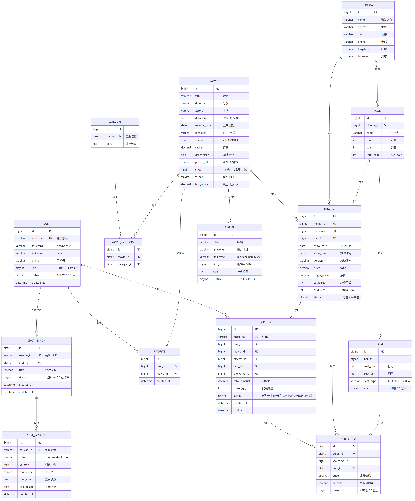
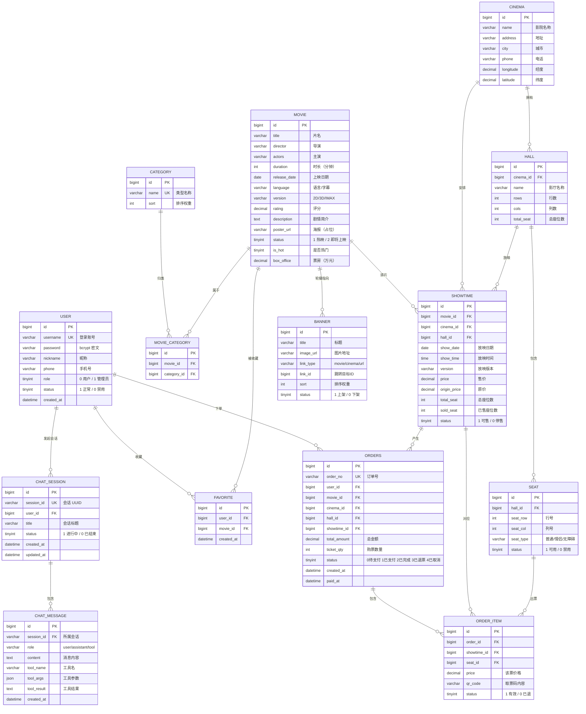

# 数据库设计说明（ER 图与表结构）

> 数据库：`cinema_db`，字符集 `utf8mb4`，存储引擎 InnoDB
> 建表脚本：[init.sql](../database/init.sql)；初始化数据：[seed_movies.sql](../database/seed_movies.sql)

---

## 一、ER 图

图片版（可直接用于论文与答辩 PPT）：

> 源文件为下方 Mermaid 代码，PNG 由 `@mermaid-js/mermaid-cli` 渲染导出，修改代码后需重新导出。

> 说明：`CHAT_MESSAGE` 通过 `session_id`（UUID 字符串）关联 `CHAT_SESSION`，而非主键 ID，
> 便于按业务标识直接查询，无需二次定位会话主键。

---

## 二、实体关系说明

| 关系 | 基数 | 业务含义 |
| --- | --- | --- |
| 用户 — 订单 | 1 : N | 一个用户可有多笔订单 |
| 用户 — 收藏 | 1 : N | 一个用户可收藏多部影片（`uk_user_movie` 保证不重复） |
| 影片 — 类型 | M : N | 通过 `movie_category` 中间表实现多对多 |
| 影院 — 影厅 | 1 : N | 一家影院拥有多个影厅 |
| 影厅 — 座位 | 1 : N | 影厅按 `rows × cols` 生成座位 |
| 影片 — 场次 | 1 : N | 一部影片在多个影院/影厅/时段排片 |
| 场次 — 订单 | 1 : N | 一个场次可产生多笔订单 |
| 订单 — 订单明细 | 1 : N | 一笔订单包含多张票（每座位一条明细） |
| 场次 / 座位 — 订单明细 | 1 : N | 明细记录该票所属场次与座位，用于占座与退票释放 |

**座位占用判定**：`order_item.status = 1` 且所属订单 `status IN (1,2)` 时视为已售；
取消（订单 4）与退票（订单 3）会把明细置为 `status = 0`，座位随之释放。

---

## 三、索引设计

| 表 | 索引 | 用途 |
| --- | --- | --- |
| `user` | `uk_username`、`idx_phone` | 登录唯一性、按手机号检索 |
| `movie` | `idx_status`、`idx_rating` | 热映/即将上映筛选、评分排序 |
| `movie_category` | `uk_movie_category`、`idx_category` | 防重复关联、按类型反查影片 |
| `cinema` | `idx_city` | 按城市筛选影院 |
| `hall` | `idx_cinema` | 按影院查影厅 |
| `seat` | `uk_hall_row_col` | 同一影厅行列唯一，避免重座 |
| `showtime` | `idx_movie_date`、`idx_cinema`、`idx_hall` | 影片+日期查场次、按影院/影厅排期 |
| `orders` | `uk_order_no`、`idx_user`、`idx_status`、`idx_showtime` | 订单号唯一、我的订单与状态筛选 |
| `order_item` | `idx_order`、`idx_showtime`、`idx_seat` | 订单详情、场次占座查询 |
| `favorite` | `uk_user_movie` | 防重复收藏 |
| `chat_session` | `uk_session_id`、`idx_user` | 会话唯一标识、我的会话列表 |
| `chat_message` | `idx_session` | 按会话取历史消息 |

---

## 四、数据规模与初始化

| 数据 | 数量 | 来源 |
| --- | --- | --- |
| 影片 | 102 部（39 热映 / 63 即将上映） | `seed_movies.sql` |
| 影片类型 | 15 类 | `seed_movies.sql` |
| 影片-类型关联 | 227 条 | `seed_movies.sql` |
| 影院 / 影厅 / 座位 | 2 家 / 7 个 / 420 个 | `init.sql` |
| 场次 | 300 场（7 厅 × 7 天 × 7 时段） | `seed_movies.sql` |
| 轮播图 | 3 张 | `seed_movies.sql` |
| 演示用户 | 1 个（`testuser` / `123456`） | `init.sql` |

> 场次使用 `DATE_ADD(CURDATE(), INTERVAL n DAY)` 生成，任意时间导入后场次均落在「今天起 7 天内」，
> 不会因日期写死而过期。
