# 运行截图

> 采集环境：H5 端（`npm run dev:h5`），视口 390 × 844（iPhone 12 尺寸），2 倍像素密度
> 演示账号：`testuser / 123456`
> 截图目录：[screenshots/](screenshots/)

---

## 1. 登录与注册

| 登录 | 注册 |
| --- | --- |
| 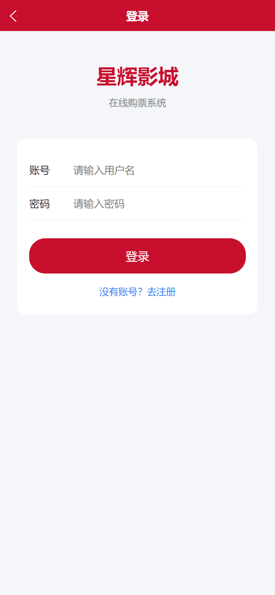 | 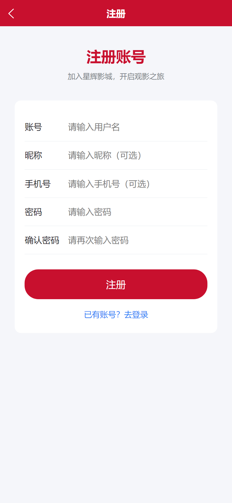 |

账号密码登录，登录成功后 Token 写入本地存储，后续请求自动携带 `Authorization: Bearer`。

---

## 2. 首页推荐

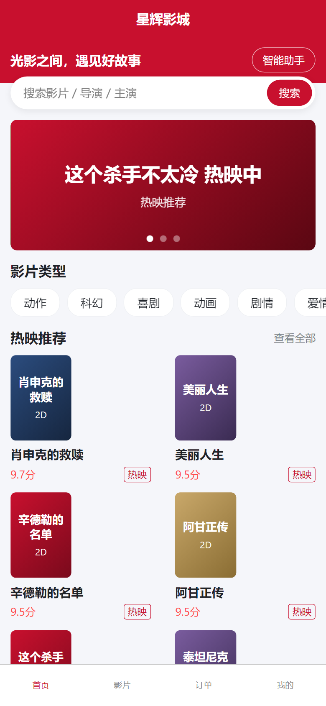

- 顶部品牌区、搜索入口、智能助手入口
- 轮播 Banner（取热门影片）
- 15 个影片类型横向滚动入口
- 热映推荐网格：片名、版本、评分、热映标签

---

## 3. 影片列表与详情

| 影片列表 | 影片详情 |
| --- | --- |
| 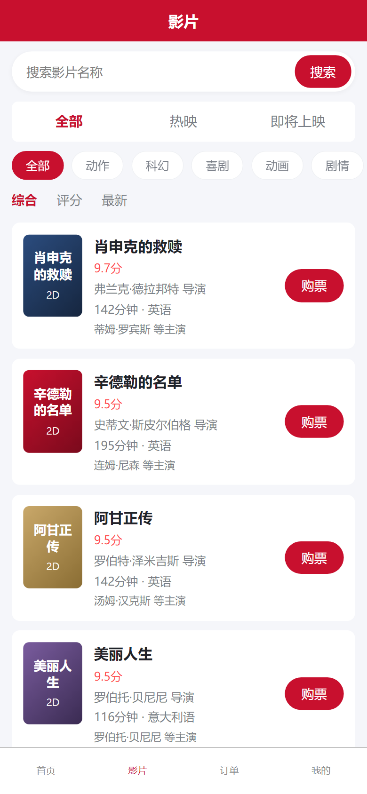 | 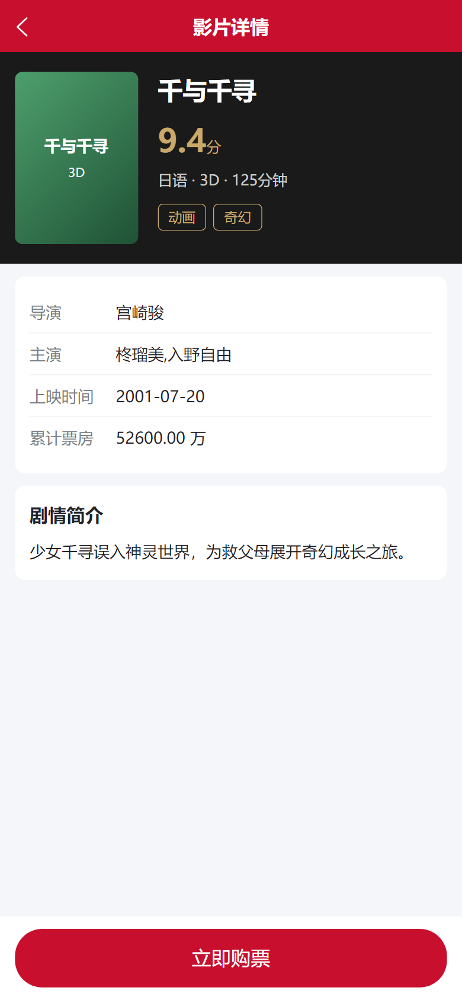 |

- 列表页支持状态（全部 / 热映 / 即将上映）、类型筛选、关键词搜索与排序（综合 / 评分 / 最新）
- 详情页展示导演、主演、上映时间、累计票房、类型标签与剧情简介，底部为购票入口

---

## 4. 场次选择

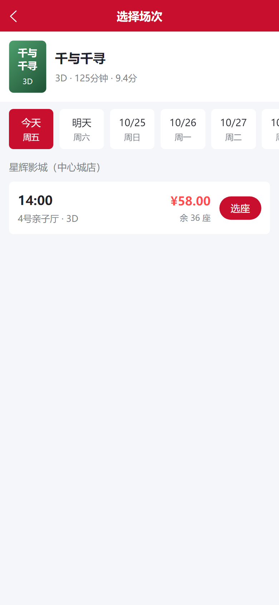

- 未来 7 天日期切换（今天 / 明天 / 日期 + 星期），无场次的日期自动跳过
- 场次卡片显示开映时间、影厅、版本、优惠价与剩余座位

---

## 5. 可视化选座

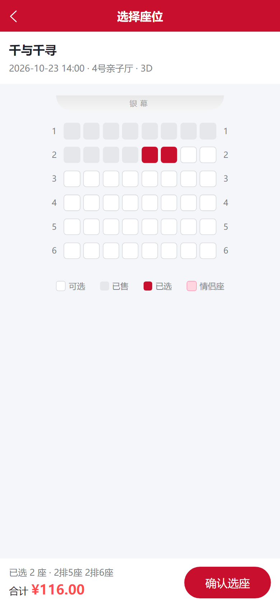

- 座位状态：可选 / 已售 / 已选 / 情侣座，四种状态用不同颜色区分
- 支持多选（上限 6 座），底部实时显示「已选 N 座 · 排座明细」与合计金额

---

## 6. 订单中心

| 订单列表 | 订单详情 |
| --- | --- |
| 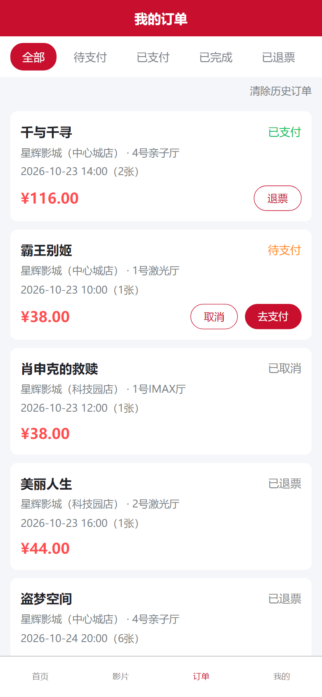 | 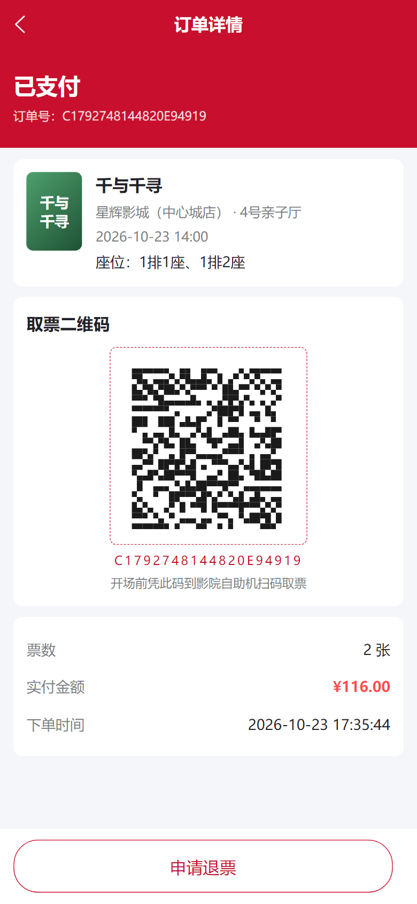 |

- 列表按状态筛选：全部 / 待支付 / 已支付 / 已完成 / 已退票
- 待支付订单可「去支付」或「取消」，已支付订单可「退票」，顶部提供「清除历史订单」
- 详情页显示状态、订单号、影片与场次、座位、票价、下单时间，并生成**真实可扫的取票二维码**

---

## 7. 观影指南

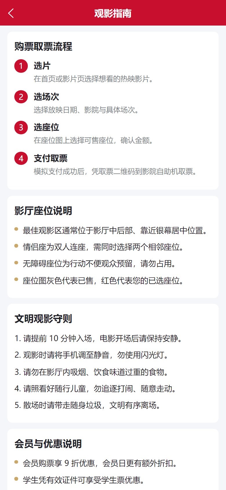

购票取票流程、影厅座位说明、文明观影守则、会员与优惠、常见问题 FAQ。

---

## 8. 智能购票助手

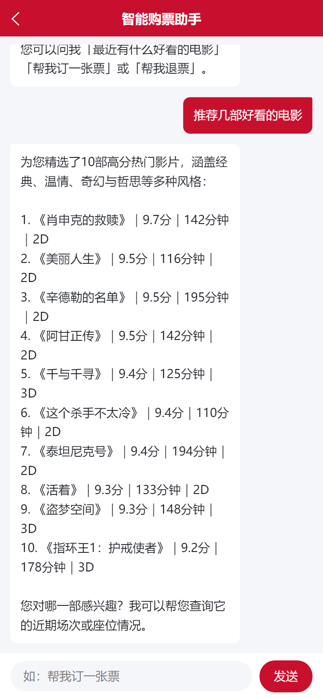

- 自然语言对话，模型经 Function Calling 调用后端工具（影片查询、场次查询、下单、退票等）
- 下单与退票等写操作会生成「确认卡片」，用户点击确认后才真正执行
- 支持会话历史恢复与新会话

---

## 9. 个人中心

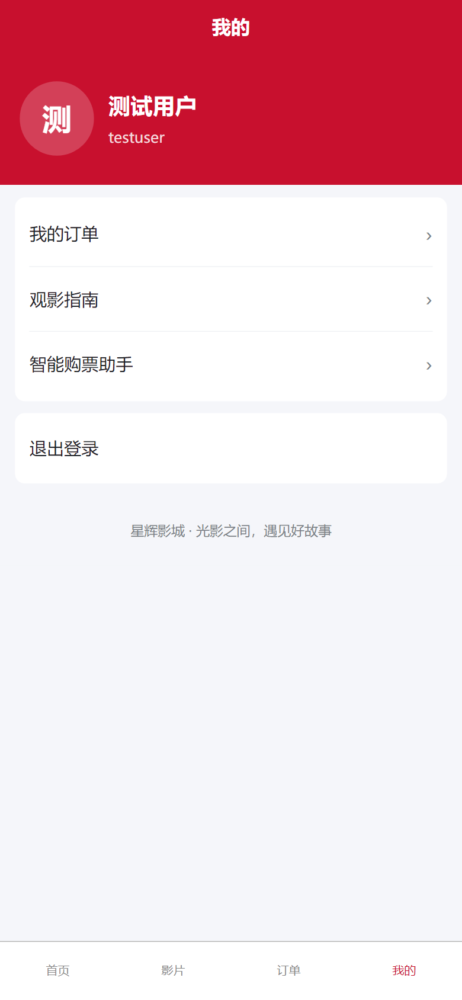

登录态展示昵称与账号，提供我的订单、观影指南、智能购票助手入口与退出登录。

---

## 附：重新采集

截图由脚本以无头浏览器（本机 Edge）自动采集，页面数据来自真实运行的后端与数据库。
若页面有改动需要重新采集，可按以下步骤：

1. 启动后端（`server` 目录 `node app.js`）与前端（`app` 目录 `npm run dev:h5`）
2. 使用 Puppeteer / Playwright 以 `390 × 844`、`deviceScaleFactor: 2` 的移动端视口访问 `http://localhost:5173`
3. 登录态写入本地存储时需使用 uni-app 的存储格式：`localStorage.setItem('userInfo', JSON.stringify({ type: 'object', data: 用户对象 }))`
4. 逐页截图后保存到本目录，文件名保持不变即可直接替换
